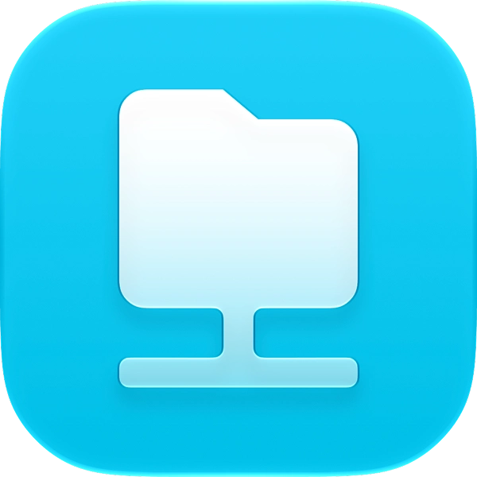
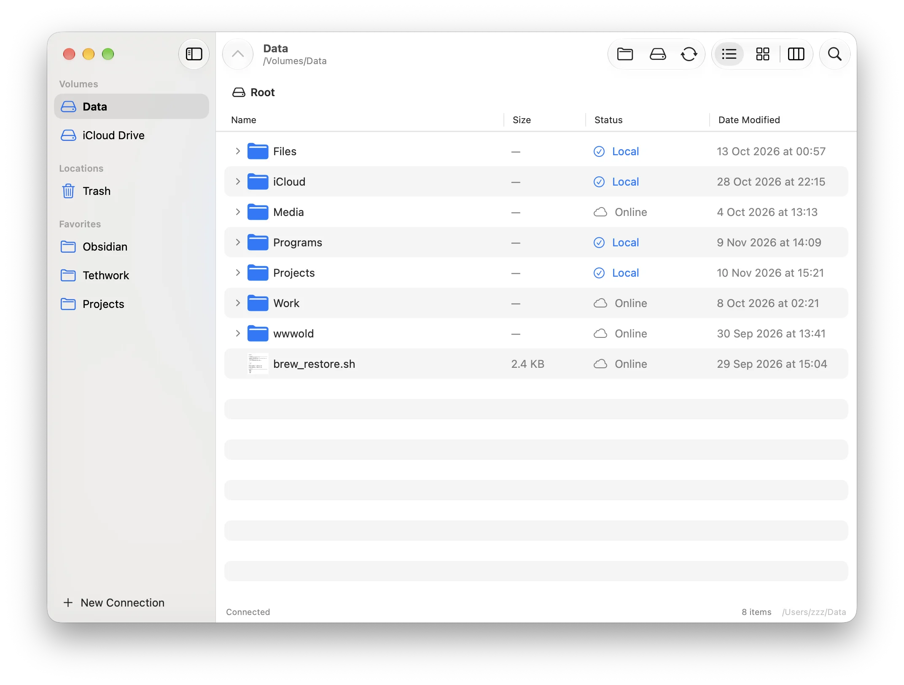

<p align="center">
  
</p>

# Tethwork

A native macOS **SwiftUI** app — a network volume browser with selective sync.

[Release notes and versions](https://github.com/yurastegny/Tethwork/releases)

> [!CAUTION]
> **iCloud synchronization is blocked.** Build 5 rejects iCloud Drive and other
> cloud-managed sync roots, including saved connections. The local file inventory
> does not enable iCloud synchronization. Data loss was reported after a reinstall;
> the cause of that incident has not been established. Keep independent backups.

> [!WARNING]
> **Beta software — use at your own risk.** Synchronization can overwrite or delete
> files on both your Mac and the network volume. Keep independent, tested backups
> before using Tethwork; synchronization and the built-in Trash are not a backup.
> The software is provided **“as is,” without warranties of any kind**. To the
> maximum extent permitted by applicable law, the author and contributors accept
> **no liability for data loss, deletion, corruption, or other damage** arising
> from its use or inability to use it. See [LICENSE](LICENSE).

## Screenshot



## Features

- Browse a mounted network volume (SMB / AFP / NFS) like Finder
- Choose which files and folders to keep on this Mac
- Two-way sync of changes
- Server-side Trash: deleted files stay on the volume for 15 days and can be restored
- Concurrent background synchronization of all connections and session restore
- Signed Sparkle update checks in the application menu and menu-bar dropdown

## Requirements

- macOS 14+
- Xcode 26+ (Icon Composer support, Swift 5 language mode)
- XcodeGen (`brew install xcodegen`) to regenerate the project

## Build & Run

Open `Tethwork.xcodeproj` in Xcode and run the **Tethwork** shared scheme.
`project.yml` is the source of truth for project settings.

Or from the terminal:

```bash
xcodegen generate
xcodebuild -project Tethwork.xcodeproj -scheme Tethwork -configuration Debug -destination 'platform=macOS' build
```

## App icon

`Tethwork/Resources/AppIcon.icon` is the Icon Composer source. Xcode compiles its
layered appearance for macOS 26+ and a flattened `AppIcon.icns` for macOS 14/15.
`ASSETCATALOG_COMPILER_STANDALONE_ICON_BEHAVIOR = all` preserves every legacy
size through 1024 px, with system-generated margins and Retina representations.
The matching PNGs in `AppIcon.appiconset` are snapshots of that generated ICNS;
after editing the source, refresh them with `iconutil -c iconset` on the built
`Tethwork.app/Contents/Resources/AppIcon.icns`. Menu-bar icons are separate assets.

## How to Use

**Do not choose iCloud Drive or another cloud-managed directory as either sync
root.** Current sources reject iCloud/File Provider roots, their children,
ancestors and resolved symlink aliases. This also blocks unsafe saved connections
from older builds; it does not move or delete their files. Use a dedicated local
folder outside cloud storage. Do not move recovered data until independent copies
have been verified.

Normal synchronization no longer deletes unselected local files simply because
they appeared in an old sync baseline. Reloading/changing saved pins is not consent
to evict data. Only the explicit **Keep Online Only** action evicts local copies
in supported, non-cloud sync roots. Explicit deletion/Trash and conflict handling
remain separate operations; keep backups.

1. Mount a network volume in Finder → Connect to Server… (`/Volumes/...`).
2. In Tethwork, click **New Connection…**.
3. Choose the network volume and a local sync folder.
4. Use **Keep on This Mac** on a file or folder.
5. Edits in the local copy go to the network and vice versa.

- **Local**: synchronized and stored on this Mac.
- **Online**: visible in the browser, not downloaded.
- **Local** on a folder means all its logical contents are local and synchronized,
  even when its files were pinned individually rather than pinning the parent.
- **Partially local** means some contents remain online-only. Nested and hidden
  user files count; paired AppleDouble `._` metadata files do not count as separate
  online-only documents.
- Folder contents are checked serially in the background and cached. **Checking…**
  is shown until the result is known. These badges never pin a parent or download
  its other files; keeping future files automatically still requires pinning it.
- **Could not check** means a folder could not be read. Background retries refresh
  its parent listing too, so a renamed or deleted child cannot leave a stale error
  on its ancestors. Persistent access errors remain visible.

The two roots must not overlap, including through symbolic links. Existing local
files are adopted additively when creating a connection; initial name collisions
keep both versions. A failed adoption can be retried with **Sync Now**.
Local-only files awaiting adoption/upload are shown as **Pending sync** instead
of disappearing until the final transfer completes. Local storage eviction is
blocked until a failed initial adoption has been retried successfully.

Use **View → Show Hidden Files** (⌘⇧.) to browse user dotfiles such as `.env` or
`.hy2test`. Internal Tethwork state, Trash and staging files remain hidden. This
visibility setting does not exclude dotfiles from synchronization.

## Local file inventory (build 5)

Tethwork keeps a diagnostic record of expected local paths for each connection in
`~/Library/Application Support/Tethwork/LocalInventory`. **Settings → Open local
file inventory** opens this folder. It is outside the app bundle and sync roots:
replacing the application does not remove it. Deleting Application Support does.

- `<key>.json`: current expected paths, known sizes, modification times, file IDs,
  confirmation times, selected paths and last successful operation. The SHA-256
  key separates connection IDs and root pairs. Imported legacy expectations can
  lack metadata or a confirmation time; directories can also appear in the list.
- `<key>.previous.json`: the immediately preceding complete snapshot.
- `<key>.events.jsonl`: append-only events with ISO-8601 timestamps, including
  session/build information, selection changes, operations and pre-sync audits.
  Audits distinguish missing paths, cloud-only placeholders, access errors and an
  unavailable root. Explicit completed eviction/Trash actions retire expectations
  while retaining their metadata in the journal. Renames remap expected paths.

Changing saved selections, an incomplete pass or an absent file does not erase
expectations. Valid legacy sync-state and verification-cache metadata seed the
first snapshot. New verified files are checkpointed about every five seconds and
at operation completion/disconnection; an abrupt crash can lose recent additions.

This is **diagnostic metadata, not a backup or a synchronization baseline**. It
never restores or deletes user files and does not change synchronization rules or
unblock cloud roots. It cannot reconstruct an incident predating installation,
identify which external program removed a file, or guarantee a consistent audit
while other programs are changing files. Inventory failures are logged to the
macOS system log and do not stop synchronization; corrupt snapshots are not
silently replaced. Journals are not automatically pruned, so their size can grow.

No document contents are recorded. Paths, root names, file metadata and error
messages can still be sensitive: the registry directory is created with
owner-only permissions. Back it up separately and review it before sharing.

## Reconciliation and safety

- The menu-bar menu uses persistent native items. Progress text updates in place;
  its width is held at 240 pt by a native minimum width and pixel-measured title
  truncation, so changing counts/estimates do not resize it.
  while pause options are open, it freezes menu text/geometry so updates cannot
  dismiss the submenu. Expanded transfer details replace the compact footer
  progress instead of duplicating it.
- Initial adoption tolerates a local child disappearing between enumeration,
  comparison and copying (for example a rotating Photos/Spotlight journal).
  Partial temporary payloads are discarded; existing server copies are retained.
  Permission errors and loss of the source root still fail visibly. This is not
  a consistent snapshot of an active Photos library or database. Use an
  app-aware backup or a filesystem snapshot when a consistent backup is required.
- Initial upload shows transferred bytes, file counts and an approximate time
  remaining in the transfer panel and menu-bar menu. The estimate warms up for
  10 seconds and uses roughly the last 45 seconds of byte and file throughput,
  including per-file overhead. A local metadata inventory runs first, without a
  fabricated percentage. Existing-file comparison, upload and final verification
  then report separate byte/item progress and estimates for the current stage.
  Comparisons are chunked/cancellable, so a large matching file is not a silent
  wait. Ordinary streaming sync does not invent an unknown total.
- Every configured volume has its own synchronization engine, watchers, progress
  and retry state. Selecting a volume only changes the browser; other volumes
  keep synchronizing their pinned files. Unavailable volumes retry independently.
  Sidebar indicators show activity or an error (hover for details).
- Initial adoption of existing local files also runs in the background. Removing
  a connection stops only its own work. **Disconnect** suspends the selected
  volume until it is selected again; global pause prevents new automatic passes
  on all volumes while allowing an already running synchronization/upload to finish.
- Normal synchronization uses **last-write-wins** (modification time). Overwrites
  of differing versions with timestamps less than five minutes apart produce a
  visible warning and a system log entry. This is a heuristic, not version history;
  clocks on all Macs and the server should agree. Keep independent backups.
- Failed automatic sync retries with exponential backoff, capped at 60 seconds.
  **Sync Now** bypasses the backoff.
- Browsing prefetches directory-entry metadata instead of issuing an explicit stat
  for every remote child. Returning to a volume first displays its cached root
  listing and then refreshes it; cached listings are never synchronization baselines.
  Pollers start after the first listing, and Trash maintenance is not restarted on
  every volume switch.
- Switching volumes retains their last-known folder badges while fresh inventory
  runs in the background. Display snapshots are isolated by both roots and pin
  policy; missing local folders and new scan results override them. They never
  replace a synchronization baseline or suppress actual transfer progress.
- Successful byte comparisons are retained for status display, including when
  SMB and local modification times have different precision. A size/mtime change
  on either side invalidates this verification; **Sync complete** alone never
  forces every row to **Local** or hides real pending changes.
  SMB listings can lose a symbolic link's type flag and report its XSym container
  size. A local link counterpart triggers an exact remote metadata read in both
  browsing and search, preventing false **Pending sync** badges on its ancestors.
- Verified comparisons and completed copies are saved locally in
  `.tethwork-verification-cache.json`, bound to both sync roots. Unchanged size,
  modification time and file identity let subsequent syncs (including after a
  restart) skip reading the contents again. Partial progress is checkpointed
  approximately every five seconds while verifying files and on completion or
  failure; a corrupt cache simply causes a fresh check. This cache is never uploaded
  and never serves as the deletion baseline. Directory inventory and shared Trash
  checks still run. **Sync → Full Content Check** discards cached verification and
  reads contents again; use it for suspected edits preserving both size and mtime.
- The local sync root is observed by one recursive FSEvents stream, so thousands
  of synchronized folders do not consume one kernel descriptor each.
- Network directories are polled shallowly instead of holding kernel descriptors
  for every folder. This keeps change coverage on SMB/AFP without exhausting the
  process file-descriptor limit during synchronization.
- Individually adopted file pins are observed through their containing directories
  rather than polling every file independently.
- Before reuploading a previously synchronized local-only path, the shared Trash
  index is checked. If the path or an enclosing folder is in Trash, the stale local
  copy is removed rather than resurrecting a deletion from another Mac.
- This protection only lasts while the shared Trash record exists. Emptying Trash,
  expired retention, an inaccessible/corrupt index, or a client that was offline for
  longer than retention cannot provide durable cross-Mac deletion history.
- Writes stage a cancellable copy alongside the destination, verify its size and
  source modification time, and publish only after copying succeeds. A failed
  write leaves the existing destination intact. File/directory swaps use a backup;
  `.tethwork-backup-*` crash leftovers are deliberately never automatically deleted.
- Comparisons/copies use bounded POSIX reads/writes, filling short chunks and
  retrying interrupted calls. FIFOs/devices are rejected instead of blocking a
  sync, and symbolic links are not followed when opening a comparison source.
  Tree sync copies symlink entries themselves (including dangling links and links
  to directories), comparing link text instead of target bytes. Atomic publication
  replaces existing links without following them; staging never changes metadata
  through a link. Root-containment checks still reject paths escaping the sync roots.
  Read/write failures retain the file path and errno. Use **Details… → Copy Error**
  in the status bar to inspect the failing operation, source and destination.
- Trash index mutations use a process lock and `flock`. Network filesystem support
  for advisory locking varies; do not treat this as a transactional multi-writer
  database on servers without working advisory locks.

## Trash

Deleting an item moves it to a hidden folder on the network volume itself:

```
<network volume>/.tethwork-trash/
    index.json          original path, deletion date, pinned state
    .index.lock         persistent advisory lock (do not remove while running)
    <uuid>/<name>       the deleted file or folder
```

Because the payload stays on the share, all Macs connected to the same volume share the same Trash.

- Items are kept for **15 days**, then removed automatically (checked on connect, when Trash is opened, and hourly while the app is running).
- Deleting a **local synced copy in Finder** is tracked through the sync baseline and also moves the network copy to Trash (marked with a laptop icon) instead of deleting it permanently. This works even if the app was closed at the time of deletion — the baseline is persisted in `.tethwork-sync-state.json`.
- Open **Trash** in the sidebar (or ⌘⇧T) to see deleted files grouped by network connection, restore them to their original folder, or remove them permanently. Empty Trash affects all available connections.
- Restoring into a folder that already has an item with the same name adds a Finder-style ` 2` suffix instead of overwriting.
- Files that were kept on this Mac are downloaded again after restore.

Invalid metadata and paths cannot restore outside the selected volume. Corrupt
indexes are copied to `.index.corrupt-*` for diagnosis; orphan payloads remain
recoverable by scanning Trash, though their original nested path may be lost.
An index write failure is reported even when payloads were already moved.

Trash shows file-type icons without opening payloads for Quick Look thumbnails.
Before moving/restoring/removing items, the app cancels its matching thumbnail
requests and releases its matching Quick Look preview. Transient server `EBUSY`
errors get three bounded retries; persistent busy/permission errors remain visible
and failed records are not marked as deleted. The app never kills other apps,
changes permissions or force-unmounts a share to bypass a busy file.

## Tests

The isolated regression harness uses temporary directories, not configured shares:

```bash
python3 Tests/run_tests.py
python3 Tests/run_tests.py --sanitize-thread --repeat 3
python3 Tests/run_tests.py --suite trash --compile-timeout 180 --run-timeout 120
xcodebuild -project Tethwork.xcodeproj -scheme Tethwork -destination 'platform=macOS' test
```

The harness covers reconciliation, adoption, Trash containment, unpinning,
favorites, cancellation and concurrent watcher lifecycle. Xcode also runs a small
XCTest integration target. CI runs build, XCTest and the isolated harness with
Thread Sanitizer. Manual validation on the actual SMB/NFS server remains necessary
for permissions, locking, dropped connections and multi-Mac races.

## Signing and distribution

Debug builds use ad-hoc signing with hardened runtime disabled; Release archives
enable hardened runtime and must be signed with a Developer ID for distribution.
The app is not sandboxed and only accesses folders selected
by the user. macOS privacy prompts still apply to protected and network folders.

For distribution, supply your own Developer ID and Team ID without committing
credentials. Enable hardened runtime for the signed archive:

```bash
xcodebuild -project Tethwork.xcodeproj -scheme Tethwork -configuration Release \
  -archivePath build/Tethwork.xcarchive archive \
  CODE_SIGN_IDENTITY='Developer ID Application: YOUR NAME (TEAMID)' \
  DEVELOPMENT_TEAM=TEAMID ENABLE_HARDENED_RUNTIME=YES
```

Export with Developer ID, submit the signed ZIP/DMG using `xcrun notarytool submit
--keychain-profile YOUR_PROFILE --wait`, then `xcrun stapler staple` the app/DMG.
No certificate, credentials or notarization approval are included in this repo.

### Sparkle updates

Sparkle 2.10.1 is pinned through Swift Package Manager. Its [license and third-party
notices](Tethwork/Resources/Sparkle-LICENSE.txt) are included in the application.
The HTTPS feed is [`updates/appcast.xml`](updates/appcast.xml). Both the feed and
downloaded ZIP archives require Ed25519 signatures; archives are verified before
extraction. The public key is embedded in `Info.plist`. The private key lives only
in the login Keychain under the Sparkle account `app.tethwork.Tethwork` and must
never be committed or uploaded. Keep a secure backup of this key outside Git.

Sparkle asks permission for scheduled update checks; silent installation is off.
Use **Check for Updates…** in the application menu or menu-bar dropdown for a
manual check. Beta builds accept the `beta` channel as well as stable updates.
Installing an update waits for active synchronization/initial upload to finish.
Increase `CURRENT_PROJECT_VERSION` for every distributed build, even when the
marketing version is unchanged. Builds made before Sparkle was added need a
one-time manual installation of a Sparkle-enabled release.

### Publishing a notarized release

1. Create a universal Release archive using the Developer ID command above with
   `ARCHS='arm64 x86_64' ONLY_ACTIVE_ARCH=NO DEVELOPMENT_TEAM=YOUR_TEAM_ID`.
2. Open the `.xcarchive` in Xcode Organizer and choose **Distribute App → Direct
   Distribution** (or **Developer ID → Upload**). Wait for Apple's notarization
   to succeed, then **Export Notarized App**. Alternatively, submit the archive
   using a locally stored `notarytool` profile and staple the accepted app.
3. Resolve Swift packages and locate Sparkle's `bin` directory under
   `<DerivedData>/SourcePackages/artifacts/sparkle/Sparkle/bin`, then run:

   ```bash
   python3 scripts/package_release.py /path/to/notarized/Tethwork.app \
     --sparkle-bin /path/to/SourcePackages/artifacts/sparkle/Sparkle/bin
   ```

   This refuses unnotarized, unstapled, incorrectly signed or non-universal apps.
   It verifies the Keychain key matches the embedded public key, creates a ZIP
   preserving framework symlinks, signs the archive and feed, and emits SHA-256
   checksums. Output is under `build/releases/<tag>/`, outside Git.
4. Publish the ZIP and `SHA256SUMS` in the matching GitHub Release. Beta builds
   use `v<version>-beta.<build>` and must be marked as a prerelease. Only **after**
   the asset is available, copy the generated `appcast.xml` into `updates/`,
   commit and push. Do not edit signed XML by hand; regenerate/re-sign it.

Developer ID signing and Apple notarization are separate from Sparkle signing.
Do not publish ad-hoc signed development builds as notarized releases.

## License

See `LICENSE`. No open-source license is assumed for the owner's code.
